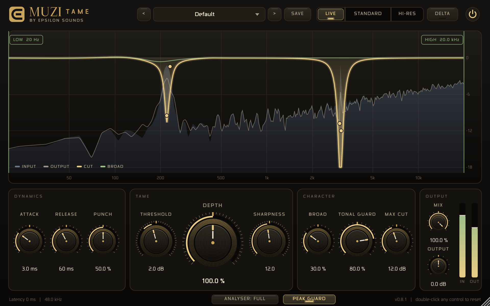

# Muzi Tame v0.5 — FrankenTame engine

Automatic resonance suppressor (JUCE, VST3 / AU / Standalone). Full user guide: `Muzi Tame Manual.pdf`.

## What's new in v0.5
- **Polyphonic Tonal Guard.** v0.4 only protected the harmonics of one note, so melodies, arpeggios and chords were cut as if they were resonances. v0.5 finds up to four notes at once (harmonic summation with estimate-and-cancel), also on a long low-end spectrum for bass notes, and tells resonances from melody by how long a peak stays at one frequency. Note partials are protected in proportion, however loud they are.
- **Punch** (transient guard). A fast/slow envelope detector, read ahead through the latency buffer, eases every cut above ~250 Hz for the moment a drum hit or pluck passes, so hits keep their snap while the ring between them is still cut.
- **Low-end resolution.** Regions below 300 Hz now read a 4x longer FFT, so narrow bass and room resonances can be resolved. Low bells may not move faster than ~2 cycles of their own frequency, which stops them reshaping bass waveforms and raising peaks.
- **CPU path.** Plugin builds use `juce::dsp::FFT` (Apple vDSP on macOS). Results are identical to the built-in FFT.
- Pitch estimates use a weighted median of the matched partials, so a partial borrowed from another note no longer skews them.

Old sessions open with Punch at 50 %.

## Open and build (Mac)
Everything is inside this folder, including JUCE 9.0.5 (in `JUCE/`), so nothing else needs downloading.

1. Double-click **`MuziTame.jucer`**. It opens in Projucer with all the code in.
2. Click the Xcode button at the top (Save and Open in IDE).
3. In Xcode choose the scheme **Muzi Tame - All**, then Product > Build (a Release build runs lightest).
4. Xcode copies the plugin to `~/Library/Audio/Plug-Ins/VST3/` and `Components/` (AU). Rescan in your DAW.

You can also open `Builds/MacOSX/Muzi Tame.xcodeproj` directly. JUCE 9.0.5, macOS 12.0 target, Apple Silicon + Intel (Xcode standard architectures), VST3 + AU + Standalone. Windows: `Builds/VisualStudio2022`.
Plugin ID is unchanged (Muzi / MzTm), so sessions that already use Muzi Tame keep loading it.

CMake alternative: `cmake -B build -DCMAKE_BUILD_TYPE=Release && cmake --build build --config Release` (downloads JUCE 9.0.5).

## Controls
| Control | What it does | Default |
|---|---|---|
| Mode | Standard: 2048-pt analysis, 32 ms latency. High-res: 4096-pt, 91 ms latency, faster attack, finer detail (mixing/mastering) | Standard |
| Depth | Scales every cut | 100 % |
| Threshold | dB above the local spectral envelope before cutting starts | 2 dB |
| Sharpness | Q of the narrow (moving) bells | 12 |
| Attack / Release | How fast cuts engage / let go | 3 ms / 60 ms |
| Punch | Eases cuts during drum hits and plucks (above ~250 Hz) | 50 % |
| Broad | Amount of the slow, wide "tonal balance" layer | 30 % |
| Tonal Guard | Protects musical notes: melodies, chords, harmonics, bass notes. Lower it to chase moving or on-and-off resonances harder | 80 % |
| Max Cut | Deepest any band may go | 12 dB |
| Mix | Dry/wet | 100 % |
| Output | Output trim | 0 dB |
| Low / High Limit | Processing range (drag handles in the display) | 20 Hz / 20 kHz |
| Delta | Hear only what is removed | off |
| Bypass | Power button; keeps latency | off |

## Measured (Resonance Lab, defaults, through the built VST3)
| Test | v0.4 | v0.5 Standard | v0.5 High-res |
|---|---|---|---|
| Latency | 1536 | 1536 samples (32 ms) | 4352 samples (91 ms) |
| Planted peaks 650 / 2400 / 5200 / 9000 Hz | −3.6 / −2.7 / −5.6 / −2.0 dB | −3.3 / −2.5 / −5.1 / −1.8 dB | −2.9 / −2.3 / −4.9 / −2.0 dB |
| Clean pink noise, worst cut | −0.29 dB | −0.03 dB | −0.01 dB |
| Fast melody (arpeggio), worst 1/3 octave | −1.41 dB | −0.18 dB | −0.71 dB |
| Sustained chord, worst 1/3 octave | −3.58 dB | −1.16 dB | −0.11 dB |
| Chord notes (mean / worst partial) | −4.5 / −11.5 dB | −0.16 / −0.9 dB | −0.42 / −1.9 dB |
| Real resonance hidden in the chord | −1.24 dB | −1.05 dB | −1.59 dB |
| Drum hits: peak change / ring cut between hits | −0.34 / −4.7 dB | −0.15 / −4.6 dB | −0.16 / −4.6 dB |
| Pitched 220 Hz note | −0.12 dB | −0.04 dB | −0.49 dB |
| Attack / release, gated resonance | 29 / 16 ms | 38 / 16 ms | 14 / 16 ms |
| Moving resonance 300 Hz → 6 kHz | −3.7 dB | −0.6 dB | −0.7 dB |

On a real 2-minute master (JOJO), full range, High-res: the melodic intro/outro lose 0.3–0.8 dB below 2 kHz (v0.4: 2–3 dB), the 5.6 kHz spike is cut 4.3 dB, bass is untouched (−0.1 dB), true peak is unchanged, and fewer drum hits lose punch (6 windows vs 17).

The built VST3 gives the same numbers as the engine, at any block size. Bypass output equals the delayed input exactly; state round-trips.

## Trade-offs to know
- **Moving or on-and-off resonances** are cut less than in v0.4, because the guard can't tell them from melody notes. Lower Tonal Guard to chase them harder (at some cost to melodies), or narrow the range around them.
- **Wide low bumps** (room modes wider than about Q 8) are left mostly to the Broad layer. Narrow low resonances are resolved better than before, but cuts there stay gentle.
- **CPU:** ~18 % of one x86 core per stereo instance with the built-in FFT (Linux test machine); the macOS build uses vDSP and should be lighter (not measured here).

## Layout
- `MuziTame.jucer` - Projucer project (+ generated `Builds/` and `JuceLibraryCode/`); `JUCE/modules` - JUCE 9.0.5, bundled
- `Source/FrankenTameEngine.h` — the DSP, header-only, no JUCE dependency (optional JUCE FFT), no allocation after `prepare()`
- `Source/PluginProcessor.*` — parameters, presets, both modes pre-prepared (switching never allocates), latency reporting
- `Source/PluginEditor.*` — analyser, cut curve, range handles, knobs, meters
- `Source/MuziLookAndFeel.h` — the palette and drawing style (re-skin from one place)
- `tests/render_engine.py` — renders the Resonance Lab signals through the engine (`python tests/render_engine.py ../resonance_lab [--high-res]`)
- `tests/scorecard.py` — one-line-per-test summary of a render folder
- `tests/host/HostTest.cpp` — headless VST3 host: loads the built plugin, sets parameters by display name, renders, checks state (`cmake -B build -DMT_BUILD_TEST_HOST=ON`; `--rate` sets the sample rate)
- `tests/snapshot/Snapshot.cpp` — renders the editor to PNG with audio running: `MuziSnapshot in.wav out.png [width] [preset]`
